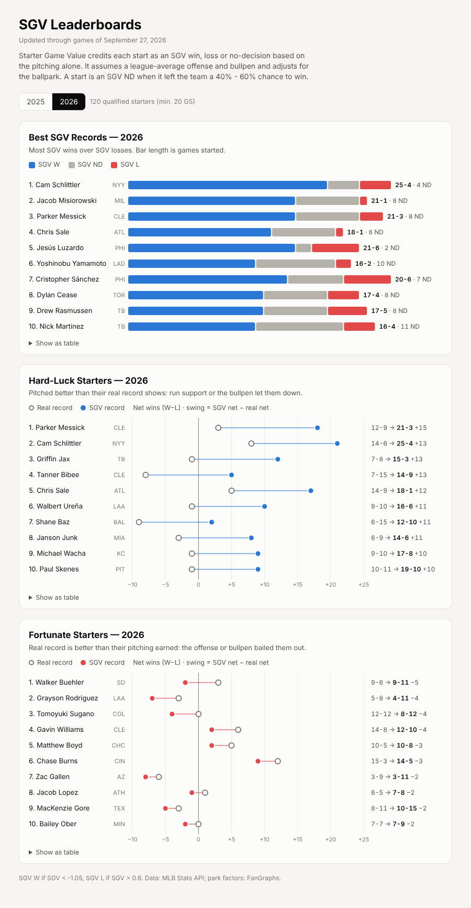

# Starter Game Value (SGV)

**A new pitching record: a win, a loss or a no-decision for every start, earned by the pitching alone.**

A starter's win-loss record depends on things the starter doesn't control. Run support varies a lot from team to team, and a bullpen can lose a quality start in a single inning. Over a season this can make a W-L record wrong by five wins or more in either direction.

SGV asks a simpler question: **did this start give the team a realistic chance to win?** Each start gets an **SGV W**, **SGV L** or **SGV ND**, assuming a league-average offense, a league-average bullpen from the moment the starter leaves, and the run environment of that ballpark. At the end of the season every starter has an SGV record (for example 22-5, 5 ND) to compare with the real one.

**Live leaderboard (updated daily during the season): https://luca-pfi.github.io/Advanced-Sabermetrics-Development-SGV/**



---

## How SGV works

### Formula

```
SGV = (Starter ER + Lg Bullpen RA9 × (9 − IP) / 9) − (Lg Runs per Team per Game × Park Factor)
```

| Term | Meaning |
|---|---|
| **Starter ER** | Earned runs allowed by the starter |
| **IP** | Innings pitched by the starter (4.2 IP counts as 4⅔) |
| **Lg Bullpen RA9** | League bullpen runs allowed per 9 innings that season, earned and unearned |
| **Lg Runs per Team per Game** | League-average runs scored per team per game that season |
| **Park Factor** | Run factor of the ballpark (FanGraphs, e.g. Coors Field 1.12, Petco Park 0.96) |

The first part estimates the runs the team allows over the whole game: the starter's earned runs, plus what an average bullpen would allow in the innings left. The second part is what an average offense would score in that park. **A negative SGV is good:** the team would expect to outscore its opponent.

The starter is charged with earned runs only, so defensive errors don't count against the pitcher. The bullpen is charged with all runs, because that's what a real bullpen gives up.

### SGV W, SGV L and SGV ND

The ND thresholds come from the data rather than being picked by hand. The script fits a logistic curve of the probability that the team wins against the SGV of the start, using every start loaded. A start is an **SGV ND** when that win probability is between **40% and 60%**, too close to call:

| Team win probability | SGV decision |
|---|---|
| above 60% | **SGV W**: the start gave the team a realistic chance to win |
| 40% – 60% | **SGV ND**: a genuine coin flip |
| below 40% | **SGV L**: the start was unlikely to produce a win |

On 2025–2026 data this works out to **SGV W if SGV < −1.05** and **SGV L if SGV > +0.60**. Teams won 73% of SGV W starts, 50% of SGV ND starts and 23% of SGV L starts. Very short starts, such as openers or starters pulled early, land in the ND zone on their own, because the game is mostly left to the bullpen.

### What SGV removes from W-L, and what it doesn't

- **Run support:** removed. Every start is compared to the same league-average offense.
- **Bullpen failures:** removed. The starter is credited for their own innings, not for what happened after they left.
- **Ballpark:** adjusted. A start at Coors Field is judged against a higher run baseline than one at Petco Park.
- **Not removed:** schedule strength (a Padres starter faces the Dodgers more often than an AL Central starter does), and the earned/unearned run distinction, which can hide the effect of poor defense.

SGV doesn't replace ERA, FIP or WAR. It answers a different question: did this starter put the team in a position to win?

---

## Results

`sgv_records.xlsx` and `sgv_report.html` in this repository contain the full 2025 and 2026 regular seasons (9,718 starts).

| Season | Lg Bullpen RA9 | Lg Runs/Team/Game | SGV W | SGV L | SGV ND |
|---|---|---|---|---|---|
| 2025 | 4.53 | 4.45 | 1,883 | 1,599 | 1,378 |
| 2026 | 4.57 | 4.48 | 1,834 | 1,567 | 1,457 |

Example: in 2025 **Paul Skenes** went 10-10 in real life, but had an SGV record of **22-5**, a swing of +17 net wins.

---

## How to use it

### Requirements

- Python 3.9+
- An internet connection to `statsapi.mlb.com` (the free MLB Stats API, no key needed)

```bash
pip install -r requirements.txt
```

### Run

```bash
python sgv.py
```

This scores the 2025 and 2026 regular seasons and then:

1. downloads every finished game and its box score from the MLB Stats API, the first time only (about 2 minutes);
2. works out each season's league bullpen RA9 and runs per team per game;
3. reads the park factors from `park_factors.csv`;
4. fits the win-probability curve and the ND thresholds;
5. writes `sgv_records.xlsx` and `sgv_report.html`, and opens the report in your browser.

### Outputs

**`sgv_records.xlsx`**

| Sheet | Content |
|---|---|
| **SGV Records** | One row per starting pitcher and season: GS, SGV W, SGV L, SGV ND, SGV W-L, average SGV, and the actual W, L, ND and W-L. GS = W + L + ND. |
| **Starts** | Every start: date, teams, ballpark, park factor, IP, ER, SGV, win probability, SGV decision, actual decision and team result |
| **Model** | League averages and SGV totals per season, and the ND thresholds used |

**`sgv_report.html`** has three leaderboards per season, for qualified starters (at least 1 GS per 8 team games, which is 20 GS over a full season):

- **Best SGV Records:** most SGV wins over SGV losses.
- **Hard-Luck Starters:** SGV record much better than the real one; the offense or bullpen let them down.
- **Fortunate Starters:** real record better than their pitching earned; they got bailed out.

The *swing* is (SGV W − SGV L) − (real W − real L). Hover a row for the full line, or open "Show as table".

### Options

| Option | Effect |
|---|---|
| `--seasons 2026 2027` | Seasons to score (default `2025 2026`) |
| `--nd-band 0.35` | Width of the ND zone: 0.35 means SGV ND at 35–65% win probability (default 0.40) |
| `--watch 60` | Keep running and update every 60 minutes (live mode) |
| `--refresh-days 3` | Re-download box scores from the last N days to pick up official scoring changes (default 3) |
| `--no-open` | Don't open the report in the browser |

### Live use during a season

Box scores of finished games are saved in `cache/` (about 2 KB per game), so later runs only download new games and take a few seconds. During a season the league averages are season-to-date. Include the previous seasons so the ND thresholds stay stable from opening day:

```bash
python sgv.py --seasons 2025 2026 2027 --watch 60
```

The simplest way to run it live is the daily GitHub workflow below; it needs no computer of your own.

---

## Live leaderboard (GitHub Actions + GitHub Pages)

`.github/workflows/sgv-daily.yml` updates SGV automatically **every morning from March to October** at 08:47 UTC, after the previous night's games are final:

1. scores every regular-season start from 2025 to the current season (`--seasons 2025 … current year`);
2. commits the refreshed `sgv_records.xlsx`, `sgv_report.html` and `park_factors.csv`, but only when there were new games;
3. publishes the leaderboards on GitHub Pages at **https://luca-pfi.github.io/Advanced-Sabermetrics-Development-SGV/**, with a download link for the Excel file at `…/sgv_records.xlsx`.

The page shows "Updated through games of …" with the date of the last game included.

### One-time setup

1. In the repository on GitHub, open **Settings → Pages** and set **Source** to **GitHub Actions**.
2. Open the **Actions** tab, choose **Daily SGV update** and click **Run workflow** to run it once by hand. The first run downloads every box score (a few minutes); after that each run takes about a minute.

### Each season

- **March, before opening day:** check `park_factors.csv`. New-season rows for known ballparks are filled in automatically with the previous season's value and marked `carried from … - check FanGraphs` in the `note` column. Update the values from FanGraphs when they're published and clear the note. A **brand-new ballpark** is left blank, and the run **fails** until you fill it in. GitHub emails you about the failed run, and the error lists the missing ballparks.
- **Re-enable the schedule if needed:** GitHub pauses scheduled workflows in a repository with no activity for 60 days, which can happen over the off-season. If the Actions tab shows the workflow as disabled, click **Enable workflow**.
- **During the season:** nothing to do. Official scoring changes from the last 3 days are picked up automatically.

### Park factors

`park_factors.csv` has one row per season and ballpark:

```
season,venue,home_team,games,park_factor,note
2025,Coors Field,COL,81,1.12,
2027,Coors Field,COL,81,1.12,carried from 2026 - check FanGraphs
```

- Values come from the [FanGraphs Guts page](https://www.fangraphs.com/guts.aspx?type=pf) ("Basic (5yr)" column, divided by 100).
- Neutral sites (Tokyo Dome, Mexico City, Field of Dreams, etc.) aren't covered by FanGraphs and are set to 1.00. Change them if you have better values.
- When a new season starts, each ballpark already used in an earlier season gets that season's value automatically, with `carried from <season> - check FanGraphs` in the `note` column. Update the value when FanGraphs publishes the new season and clear the note.
- A brand-new ballpark is added as an empty row; the script lists it and stops until you fill it in.
- Editing the file in Excel works, including European formats (`;` separators and decimal commas).

### Tests

```bash
python test_sgv.py
```

The tests run the whole pipeline offline on a small simulated season, without contacting the API. They check the formula against hand calculations, extra-inning starts, openers, postponed and suspended games, neutral sites, the curve fit and its ND thresholds, park factors carried to a new season, the trimmed box-score cache, and that GS = W + L + ND for every pitcher.

---

## Data sources

- Game-by-game starter IP and ER, relief runs, scores, ballparks: [MLB Stats API](https://statsapi.mlb.com)
- Park factors: [FanGraphs Guts](https://www.fangraphs.com/guts.aspx?type=pf)
- League bullpen RA9 and runs per game: computed from the MLB Stats API data for each season

## Files

| File | Purpose |
|---|---|
| `sgv.py` | Main script: data download, SGV calculation, Excel output |
| `sgv_report.py` | HTML leaderboards |
| `park_factors.csv` | Park factors per season and ballpark |
| `test_sgv.py` | Offline tests |
| `.github/workflows/sgv-daily.yml` | Daily update and GitHub Pages publication |
| `sgv_records.xlsx`, `sgv_report.html` | Latest results (updated daily during the season) |
